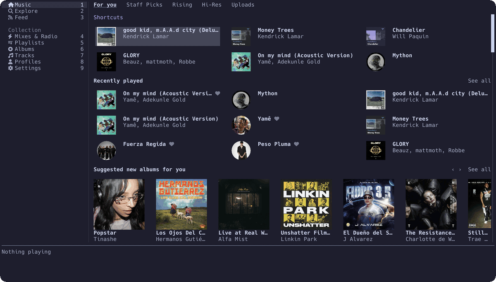

# ratidal — TIDAL terminal client (TUI) with hi-res playback

[](https://github.com/ColinTenaguillo/ratidal/actions/workflows/ci.yml)
[](https://crates.io/crates/ratidal)
[](https://ratatui.rs/)

A terminal client for TIDAL, in Rust. Browse your collection and play hi-res
audio without leaving the shell.

<p align="center">
  
</p>

> **Unofficial.** This is a third-party client with no affiliation with, or
> endorsement from, TIDAL. It talks to TIDAL's undocumented internal API, which
> can change or stop working at any time. You need your own paid TIDAL
> subscription — this does not provide access to music.
>
> **It identifies itself to TIDAL as one of their own applications.** Full
> playback is only granted to TIDAL's first-party clients, so this sends the
> `client_id` of one of them, as every third-party TIDAL client does. There is
> no honest alternative today: see
> [Credentials](#credentials) for why, and decide for yourself whether you want
> to run it.

## What works

- Device-flow login — a code and a link, confirmed in your browser
- The home page, with the same rows the web client shows
- Explore: genres, moods and decades, and the pages behind them
- Search across tracks, albums, artists and playlists
- Album pages — the tracks, the review, and the rows the web draws under
  them: more by the artist, other versions, related albums and artists
- Artist pages — top tracks, albums, singles, similar artists, biography
- Your playlists, albums, artists and favourite tracks, each in its own view,
  with the day each track was added
- Your mixes and TIDAL's stations, among the home page's rows
- A queue with shuffle and repeat, and favouriting from anywhere
- What has been played, kept between runs
- Lyrics, synced where a source has them, following the track
- Playback up to **24-bit hi-res** (FLAC in fragmented MP4, over DASH)
- The keyboard's own play/pause and next keys, and the track in the desktop's
  player widget — MPRIS on Linux, Now Playing on macOS
- Cover art through the terminal's image protocol, or half blocks where there
  is none

## Install

Needs a paid TIDAL subscription — HiFi Plus for hi-res.

Prebuilt binaries for Linux (x86_64, aarch64) and macOS 12 or later (Apple
Silicon, Intel), from the
[latest release](https://github.com/ColinTenaguillo/ratidal/releases/latest):

```sh
curl --proto '=https' --tlsv1.2 -LsSf https://github.com/ColinTenaguillo/ratidal/releases/latest/download/ratidal-installer.sh | sh
```

On Linux the binary needs ALSA at runtime — `libasound2` on Debian and
Ubuntu, `alsa-lib` on Fedora and Arch — which a desktop already has.

### From source

Needs Rust (stable), a C++ compiler for the Widevine host and CMake for
the Opus decoder. On Linux, the ALSA headers as well:

```sh
sudo apt install build-essential cmake pkg-config libasound2-dev   # Debian, Ubuntu
sudo dnf install gcc-c++ cmake pkg-config alsa-lib-devel            # Fedora
sudo pacman -S base-devel cmake pkgconf alsa-lib                    # Arch
```

Then either from [crates.io](https://crates.io/crates/ratidal):

```sh
cargo install ratidal
```

or from a checkout:

```sh
git clone https://github.com/ColinTenaguillo/ratidal
cd ratidal
cargo build --release
./target/release/ratidal
```

First run shows a code and a link. Confirm in your browser and the session is
saved until it expires.

## Keys

Press `?` in the app for the full list.

| Key | Action |
|---|---|
| `j` / `k`, `↓` / `↑` | Down / up in the list or grid |
| `Ctrl-d` / `Ctrl-u` | Half a screen down / up |
| `h` / `l`, `←` / `→` | Left / right along a row |
| `J` / `K` | Move through the sidebar |
| `1` – `8` | Straight to a nav entry — `1` is Music, `8` is Settings |
| `Enter` | Open a playlist, album or artist, or play a track |
| `Esc`, `[` | Back one view, or out of the filter or the bio |
| `]` | Forward again, through views and sections |
| `/` | Filter the current view: case and accents ignored, words in any order, letters in order will do ("kdl" finds Kendrick Lamar, below exact hits) |
| `s` | Search the catalogue |
| `o` | See all of a row |
| `b` | Open an artist's biography |
| `a` / `c` | Open the artist, or the album whose cover you are looking at |
| `R` | Radio from the selected track, or the one playing |
| `t`, `Tab` | Next tab in search |
| `Space` | Pause / resume |
| `A` | Favourite the track, or take it out again |
| `F` | Favourite the artist, album, playlist or mix under the cursor, or the one whose view is open; again to take it out |
| `n` / `p` | Next / previous in the queue |
| `.` / `,` | Ten seconds forward / back in the track |
| `e` / `E` | Queue the selected track next, or after the rest |
| `Q` | What is playing next — `j`/`k` to move, `x` to remove, enter to play |
| `z` | Shuffle the queue |
| `r` | Repeat: off, all, one |
| `S` | Sleep timer: 15, 30, 45, 60 minutes, end of track, off |
| `L` | The lyrics, synced where they are — `j`/`k` to scroll, `Esc` to close |
| `?` | The key list |
| `q` | Quit |

`Esc` steps back rather than quitting: only `q` leaves the app.

### The queue

`Q` shows what is playing next. Three things can be in it, and they are kept
apart the way Apple Music and TIDAL's own client keep them:

- **Queued** — what you asked for by name. Survives starting another album,
  because you asked for the track rather than the album it came from.
- The **album, playlist or mix** you started. Replaced when you start
  another one.
- **Autoplay** — similar tracks, filled in behind everything else as the
  queue nears its end, and refilled as long as you keep listening. Seeded
  from the last track queued, the way TIDAL's own "continue with similar
  content" is. Dropped as soon as there is something real to play, so a
  radio picked twenty minutes ago never resurfaces. On by default;
  `autoplay = false` in the config, or `i` in the queue view, stops the
  music at the end of the queue.

The keyboard's media keys work too — play/pause, next, previous — and they
reach the app whether or not the terminal has focus, since the desktop
delivers them rather than the terminal.

## Themes

Seven are built in, each taken from the values its own project publishes:

| `theme = ` | |
|---|---|
| `default` | TIDAL's own colours |
| `catppuccin` | Catppuccin Mocha |
| `gruvbox` | Gruvbox dark |
| `tokyonight` | Tokyo Night Storm |
| `nord` | Nord |
| `dracula` | Dracula |
| `solarized` | Solarized dark |

```toml
[ui]
theme = "catppuccin"
```

Any colour can be set by hand, and wins over whichever theme is named:

```toml
[ui]
theme = "catppuccin"

[ui.colors]
accent = "#f5c2e7"
selection = "#585b70"
```

The eleven names are `accent`, `text`, `dim`, `heading`, `surface`,
`selection`, `quality`, `track`, `placeholder`, `border` and `on_accent`.
Values are `#rrggbb`, with the `#` optional.

A line that cannot be read is skipped, not fatal. A misspelt colour name or a
value that is not `#rrggbb` leaves that one colour as the theme had it, keeps
the rest, and says what went wrong in the status bar and the log. An unknown
theme name falls back to `default` the same way. The app always starts.

Named themes are drawn in truecolor; `default` falls back to 256 colours where
the terminal cannot do better.

## Sound

Settings (`8`) has three rows the engine reads, all written to the config:

```toml
[audio]
normalisation = false   # bring every track to one level, from the service's own measure
gapless = true          # line the next track up behind this one
equalizer = "off"       # or flat, rock, pop, jazz, classical, electronic, acoustic,
                        # vocal, bass-boost, bass-reducer, treble-boost, loudness
```

The equaliser changes as you step through the presets. The other two restart
the engine, which picks the track back up where it was.

## Scrobbling

Name a service in the config and listens go to it: what is playing now, and
each track once it has run half its length or four minutes, as the services
themselves count it.

```toml
[scrobble]
listenbrainz = "the user token from listenbrainz.org/settings"
lastfm = { key = "an API key", secret = "its secret" }   # from last.fm/api/account/create
librefm = true
maloja = { url = "https://maloja.example.org", key = "an API key" }
```

Last.fm and Libre.fm approve the account in the browser, once, at the first
start after. The linked accounts are kept in `scrobble.json` beside the
token, mode `0600`.

## Discord

What is playing, on your Discord profile, with the album art and a clock
that counts down the track. The name shown beside it is a Discord
application's, so register one at discord.com/developers — any name you
like — and give the config its id:

```toml
[discord]
application_id = "1234567890123456789"
```

Discord not running is not an error: it is tried again a little later.

## Where things live

| What | Linux | macOS |
|---|---|---|
| Config | `~/.config/ratidal/config.toml` | `~/Library/Application Support/ratidal/config.toml` |
| Session token | alongside the config, mode `0600` | same |
| Scrobbling accounts | `scrobble.json` alongside the config, mode `0600` | same |
| Log | `~/.cache/ratidal/ratidal.log` | `~/Library/Caches/ratidal/ratidal.log` |

## Other services

The catalogue and the engine come from
[sonora](https://github.com/sonorahq/sonora)'s `music` crate, so a service
sonora knows can stand in for TIDAL. A Subsonic server — Navidrome, Gonic,
Airsonic — works today:

```toml
[provider]
kind = "subsonic"

[subsonic]
server   = "https://music.example.org"
username = "you"
```

The password is asked for on the login screen and kept by the provider's
own credential store, never written to the config. The home page shows what
the server lists, search covers tracks, albums and playlists, and favourites
work; the feed, the mixes and the hi-res badge are TIDAL's and stay empty.
`kind = "tidal"`, the default, is the client described everywhere else here.
Settings (`8`) has the same choice as its first row: pick a service with
`h`/`l`, press Enter, and the app leaves the one it is on and signs in to the
other. Each service keeps its own session, so coming back asks nothing.

The other services sonora knows sign in from the same screen, each its own
way:

| `kind`      | How it signs in |
|-------------|-----------------|
| `spotify`   | A link opens in the browser; authorise there and come back. Needs Premium. |
| `deezer`    | Paste the `Cookie` header (or just the `arl` cookie) of a signed-in deezer.com tab. |
| `apple`     | Paste the `Cookie` header of a signed-in music.apple.com tab. Playback needs Google's Widevine module: see below. |
| `youtube`   | `g` to continue as a guest, or paste the `Cookie` header of a signed-in music.youtube.com tab; with several accounts on it, pick one. |

No webview: the cookies come out of the browser's devtools (Network, any
request, Request Headers, the `Cookie` line) and are kept by the provider's
credential store, like the Subsonic password.

**Apple Music and Widevine.** Apple's streams are encrypted, and only
Google's Widevine module decrypts them. Nothing ships it — Google publishes
nothing anyone may redistribute — so once an Apple Music account is in, the
machine is searched for a browser's copy. With none, the app offers to
download the module from Google's update service, as Chrome and Kodi get
theirs, shows Google's terms out of the archive, and installs it into its
own store only on a second yes. `SONORA_WIDEVINE_CDM=/path/to/module` names
one of your own instead. Declined, Apple Music keeps its catalogue and
refuses to play. The module runs in a process of its own, this binary
started again, so its memory is spent only while an Apple track is loaded.

Your own files are a service too. The folders are read at each start, from
an index kept under the cache between runs, and every track, album and
artist found is the library:

```toml
[provider]
kind = "local"

[local]
folders = ["~/Music", "/media/flac"]
```

## Credentials

ratidal ships a `client_id` and secret belonging to one of TIDAL's own
applications, and sends them on every request. TIDAL therefore believes it is
talking to that application rather than to this one. That is a
misrepresentation, and it is worth knowing before you run it.

It is not a leak of anything private to you: your own login happens in your
browser, and your session token stays on your machine, mode `0600`. The shipped
credentials identify the *application*, not you.

There is no legitimate way to replace them today, which is the only reason they
are here:

- TIDAL's own developer portal issues credentials, but they are refused for the
  device flow — the code-and-a-link login a terminal needs. The API answers
  `Client is not a Limited Input Device client`.
- Those credentials also cap playback at 30-second previews, and only through
  TIDAL's Player SDK, which has no build for a terminal.
- Device-flow credentials are
  [documented as internal to TIDAL](https://github.com/hmelder/TIDAL/wiki/Authentication),
  and public requests for third-party access have gone
  [unanswered](https://github.com/orgs/tidal-music/discussions/321).

Every third-party TIDAL client is in the same position. That explains the
choice; it does not make it right, and if TIDAL opens a path for third-party
device clients this should change.

The pair is base64 in the source and never written to your config, so it stays
out of code search and secret scanners: every third-party client sends this
same pair, and the first copy that turns up in a grep is the one that gets
capped for all of them. It is not hidden from you — it is what this section
describes — and a release that changes it reaches every config that never set
its own.

If playback fails with **"this client_id cannot stream"** or a `4005` status,
the shipped credentials have been rate-capped. Until a release changes them,
put working ones in your config — the same ones the other third-party clients
carry:

```toml
[auth]
client_id     = "..."
client_secret = "..."
```

## Known limits

- **Not bit-perfect.** The device's physical format is left alone, so content
  is resampled to whatever rate it is already at. The quality badge reports
  what TIDAL delivered, not what reached the speakers.
- **Read-only.** No playlist editing.
- **No videos.** This plays audio, so the video rows on genre pages are left
  out.
- **10,000 items per request**, as a backstop against an endpoint that pages
  forever.

## Contributing

How the crate is laid out, what the test suites cover, and the rules the build
enforces: [CONTRIBUTING.md](CONTRIBUTING.md).

## Acknowledgements

Read while building this, and worth reading:

- **[ratatui](https://github.com/ratatui/ratatui)** and
  **[ratatui-image](https://github.com/ratatui/ratatui-image)** — the terminal
  UI and the cover art.
- **[spotify-player](https://github.com/aome510/spotify-player)** — how a
  network-backed ratatui app is put together.
- **[rmpc](https://github.com/mierak/rmpc)** — the single-flight image-encoding
  pattern.
- **[python-tidal](https://github.com/EbbLabs/python-tidal)**,
  **[tidlers](https://codeberg.org/tomkoid/tidlers)** and
  **[tiddl](https://github.com/oskvr37/tiddl)** — references for which
  endpoints exist, the DASH manifest shape, and the device flow.

## Licence

ratidal's own code is MIT — see [LICENSE](LICENSE). It links sonora's
`music` crate, which is GPL-3.0-or-later, so a built binary is distributed
under the GPL's terms. The crate is a git dependency pinned to a commit:
sonora does not publish it, which is also why this build is not on
crates.io.
